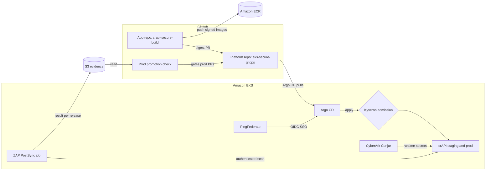

# EKS Secure GitOps

A GitOps delivery platform on Amazon EKS where nothing reaches production unless it is scanned, signed, verified at admission, and cleared by a DAST gate in staging. Workloads get secrets from CyberArk Conjur at runtime, and people reach Argo CD only through PingFederate SSO.

The workload is a fork of [OWASP crAPI](https://github.com/OWASP/crAPI), built and signed in [crapi-secure-build](https://github.com/AFP9272000/crapi-secure-build). This repo holds everything else: Terraform, GitOps config, admission policies, Conjur policy and Ping server profiles.

## Target architecture



CI never holds cluster credentials: Argo CD pulls from Git, and Kyverno admits only images signed by this project's workflows.

## Phases

| Phase | Scope | Status |
| --- | --- | --- |
| 0 | Foundations: state, KMS, GitHub OIDC roles, ECR, evidence bucket, DNS, budget | In progress |
| 1 | AWS and EKS infrastructure | Planned |
| 2 | GitOps bootstrap with Argo CD | Planned |
| 3 | Secure build pipeline: SAST, SCA, SBOM, Cosign signing | Planned |
| 4 | Admission control with Kyverno | Planned |
| 5 | CyberArk Conjur secrets | Planned |
| 6 | crAPI through GitOps | Planned |
| 7 | DAST gate and promotion | Planned |
| 8 | PingFederate SSO for Argo CD | Planned |
| 9 | Evidence, teardown and rebuild | Planned |

## Phase 0 security design

No AWS access key exists in either repo. Every CI job exchanges a short-lived GitHub OIDC token for one narrow role:

| Role | Trusted GitHub subject | Can do |
| --- | --- | --- |
| `eks-secure-gitops-tf-plan` | Platform repo pull requests and `main` | `ReadOnlyAccess`, decrypt state. Object reads outside the state bucket are denied. Pull request plans take no lock. |
| `eks-secure-gitops-tf-apply` | Platform repo environments `foundation` and `cluster`, both limited to `main` | `PowerUserAccess` plus IAM on `eks-secure-gitops-*` resources only. Every role it creates must carry the permissions boundary. It cannot change itself, the plan role, the boundary, the KMS key or the state bucket, and it cannot chain into other roles. |
| `eks-secure-gitops-image-push` | App repo `main` | Push and sign images in the project's ECR repositories. |
| `eks-secure-gitops-evidence-read` | Platform repo pull requests | Read `dast/` results in the evidence bucket for the promotion check. |

The permissions boundary is a ceiling with no IAM writes, so a role created through CI can never mint a more powerful role. The bootstrap stack owns the CI roles and runs only from an administrator's machine; CI cannot modify them.

State lives in a versioned, KMS-encrypted bucket with S3 native locking. Bucket keys are off, so every state read calls KMS, and CloudTrail records the caller and object for each one.

## Checks on every pull request

| Check | Tools |
| --- | --- |
| `static-analysis` | `terraform fmt`, `validate` and `test` (mocked provider, no credentials), TFLint with the AWS ruleset, Checkov (SARIF to code scanning), Trivy config scan |
| `plan-foundation` | Plan with the read-only role, posted on the pull request with the account ID redacted |
| `zizmor` | Static analysis of the workflows themselves |

Every action is pinned to a full commit SHA, and Dependabot keeps the pins current. A daily drift check fails if anything changed outside Terraform. Skipped checks carry their reason inline in the code.

## Layout

```text
infra/
  bootstrap/      KMS key, state bucket, GitHub OIDC provider, permissions boundary, CI roles. Run from your machine.
  foundation/     ECR, evidence bucket, Route 53 zone, ACM certificate, budget, Ping DevOps secret, workload CI roles. Applied by CI.
  backend.hcl.example
scripts/          PowerShell setup scripts for Phase 0
docs/phase-0.md   Step-by-step runbook and exit criteria
.github/          Workflows, ruleset, CODEOWNERS, Dependabot
```

## Getting started

Follow [docs/phase-0.md](docs/phase-0.md). It takes the account from empty to a CI-managed foundation in eleven steps.

## Toolchain

Terraform 1.16, AWS provider 6.69, TFLint 0.64 with the AWS ruleset 0.49, Checkov 3.3, Trivy 0.76, zizmor 1.31.
